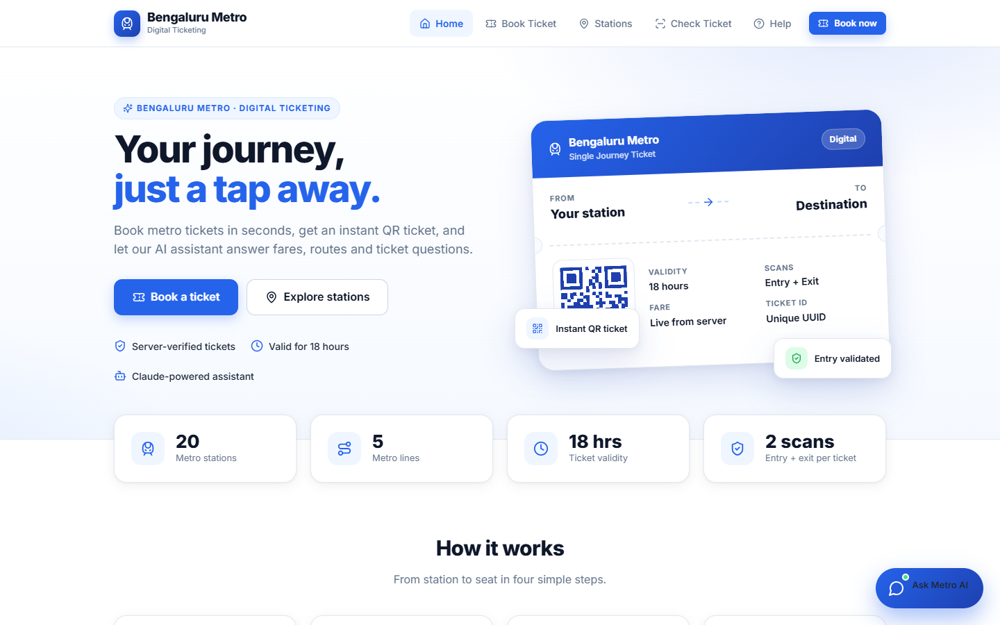
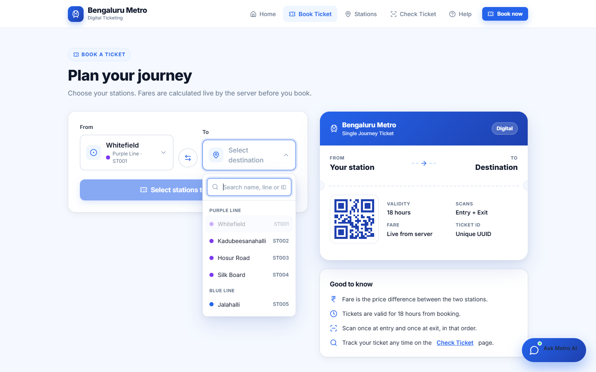
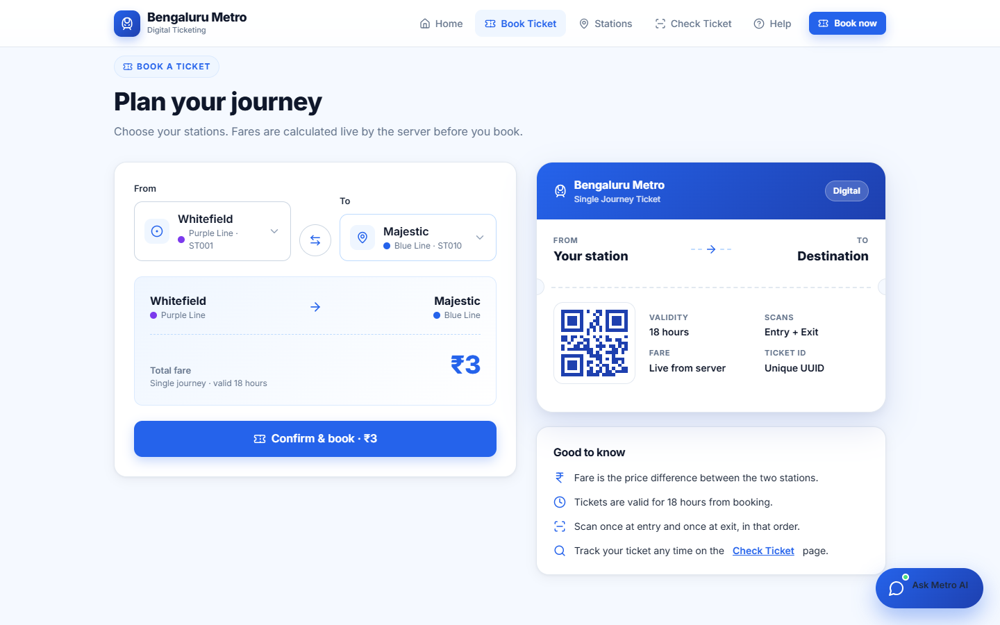
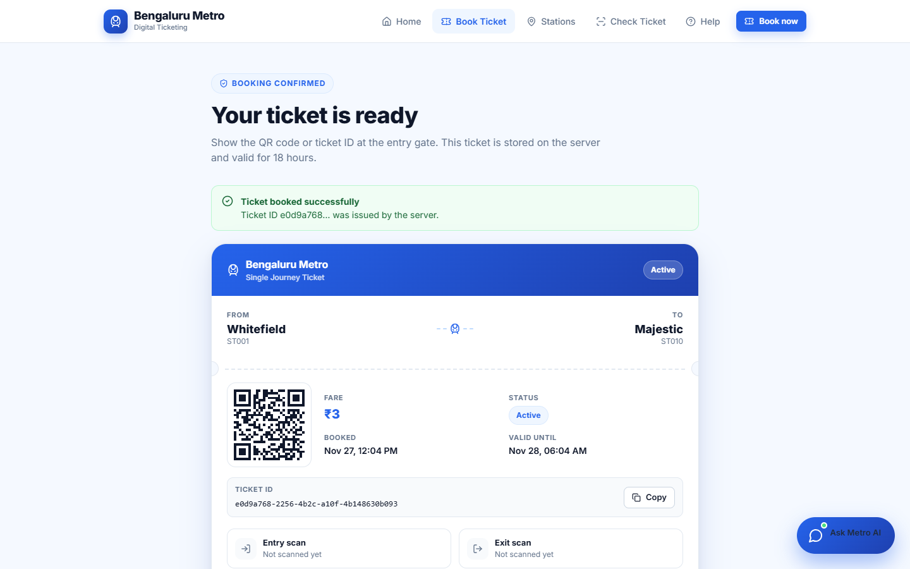
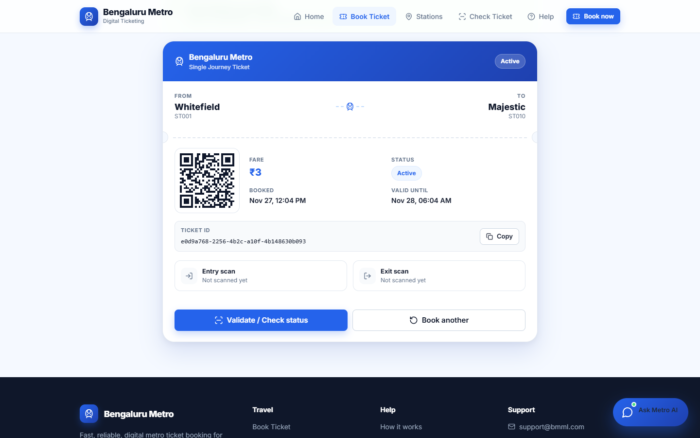
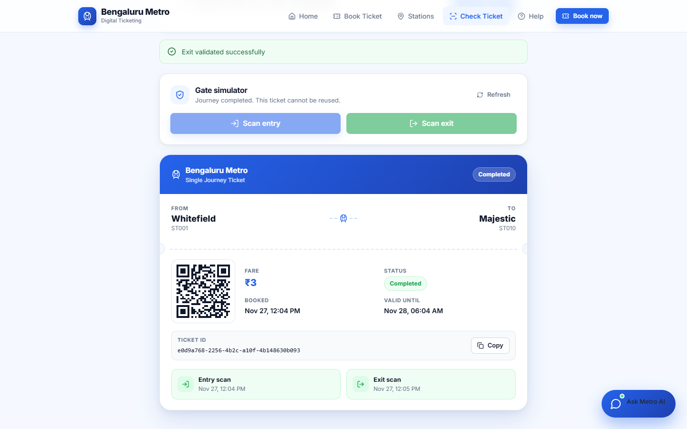

# Bengaluru Metro Ticket Booking System

A complete, professional metro ticket booking system built with React, Node.js/Express, MongoDB Atlas, and an AI chatbot powered by LangChain + Anthropic Claude.

## Features

- **20 Bengaluru Metro Stations** across 5 lines (Purple, Blue, Green, Red, Orange)
- **Fare Calculation** — based on price difference between stations
- **Digital Ticket Booking** — unique ticket ID, 18-hour expiry
- **Ticket Lifecycle** — entry scan → exit scan → completed (2 scans max)
- **Ticket Validation** — entry/exit with expiry and reuse checks
- **AI Chatbot** — LangChain + Anthropic Claude with real backend tools
- **Responsive UI** — modern, metro-themed design

## Application Screenshots

Captured from the running application (1440 × 900) with live backend and MongoDB data.

### Homepage


### Station selection


### Fare calculation


### Ticket confirmation


### Digital ticket


### Entry and exit validation


## Technology Stack

| Layer | Technology |
|---|---|
| Frontend | React 18, Vite, React Router, Lucide Icons |
| Backend | Node.js, Express.js, Mongoose |
| Database | MongoDB Atlas |
| AI | LangChain.js, Anthropic Claude |

## Architecture

```
frontend/          React + Vite (port 5173)
  └── API calls → backend/

backend/           Express API (port 8000)
  ├── /api/stations     — GET all stations
  ├── /api/tickets      — POST book, GET lookup, POST entry/exit
  ├── /api/chat         — POST AI chat
  └── MongoDB Atlas
```

## Setup

### 1. MongoDB Atlas

1. Create a cluster at [cloud.mongodb.com](https://cloud.mongodb.com)
2. Get your connection string
3. Create `backend/config.env`:

```env
NODE_ENV=development
PORT=8000
# Local MongoDB or Atlas
DATABASE=mongodb://127.0.0.1:27017/metro_tickets
ANTHROPIC_API_KEY=sk-ant-...
ANTHROPIC_MODEL=claude-sonnet-4-5
ANTHROPIC_TIMEOUT_MS=30000
CLIENT_URL=http://localhost:5173
```

`config.env` is git-ignored. The API key is only read by the backend and is never sent to the browser.

### 2. Install Backend

```bash
cd backend
npm install
```

### 3. Install Frontend

```bash
cd frontend
npm install
```

## Running

### Backend (Terminal 1)

```bash
cd backend
npm run dev
```

Server runs on `http://localhost:8000`

### Frontend (Terminal 2)

```bash
cd frontend
npm run dev
```

App runs on `http://localhost:5173`

## API Endpoints

| Method | Endpoint | Description |
|---|---|---|
| GET | `/api/stations` | Get all 20 stations |
| GET | `/api/stations/search?q=query` | Search stations |
| POST | `/api/tickets/calculate-fare` | Calculate fare |
| POST | `/api/tickets` | Book a ticket |
| GET | `/api/tickets/:ticketId` | Get ticket details |
| POST | `/api/tickets/:ticketId/entry` | Validate entry |
| POST | `/api/tickets/:ticketId/exit` | Validate exit |
| POST | `/api/chat` | AI chatbot (body: `{ message, sessionId }`) |
| POST | `/api/chat/reset` | Clear a chat session (body: `{ sessionId }`) |
| GET | `/api/health` | Health check (DB + chatbot status) |

Validation errors return `{ success: false, error, code }` with `400` (bad input), `404` (not found), `409` (duplicate scan / exit before entry / reuse) or `410` (expired).

## Fare Formula

```
fare = |destination.price - source.price|
```

## Ticket Lifecycle

1. **Booked** → ticket created, 18-hour validity
2. **Entry** → first scan, marks entry
3. **Exit** → second scan, marks completed
4. **Expired** → if not used within 18 hours

## AI Chatbot Tools

Built with `@langchain/anthropic` (`ChatAnthropic.bindTools`) and `@langchain/core` tools (zod schemas). Every tool calls the same backend services / MongoDB as the REST API.

- `get_stations` — list all stations
- `search_station` — search by name, ID or line
- `calculate_fare` — fare between two stations (IDs or names)
- `prepare_booking` — step 1: validate stations and quote the real fare (does not book)
- `confirm_booking` — step 2: books the quoted ticket. The server refuses unless a quote is pending, it was made in an earlier turn, and the user's latest message is an explicit confirmation
- `cancel_pending_booking` — discard the quote
- `get_ticket_status` — lookup ticket
- `validate_ticket_entry` — entry scan
- `validate_ticket_exit` — exit scan

Missing/invalid keys, unknown models, rate limits, overload and timeouts return clear errors (HTTP 503/502/429/504) that the chat UI shows with a retry button.

## Tests

```bash
cd backend
npm test
```

Requires a local MongoDB on `127.0.0.1:27017` (tests use throwaway `metro_test*` databases). `tests/chat.test.js` exercises the real LangChain → Anthropic SDK path against a local mock of the Messages API, so it runs without an API key.

## Troubleshooting

- **MongoDB connection fails**: Check `config.env` DATABASE URI
- **Chatbot not working**: Verify `ANTHROPIC_API_KEY` is set, then restart the backend. `GET /api/health` shows `"chatbot": "configured"` when the key is loaded
- **CORS errors**: Ensure `CLIENT_URL` matches frontend URL
- **Stations not loading**: Check backend is running and DB is connected
